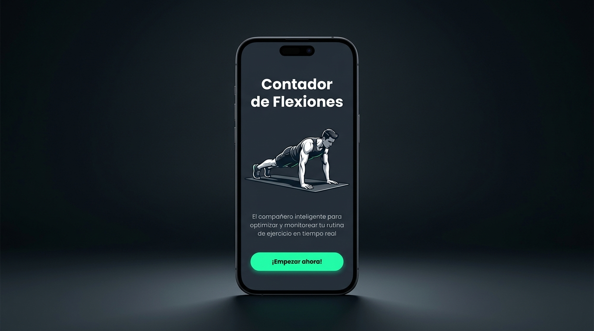
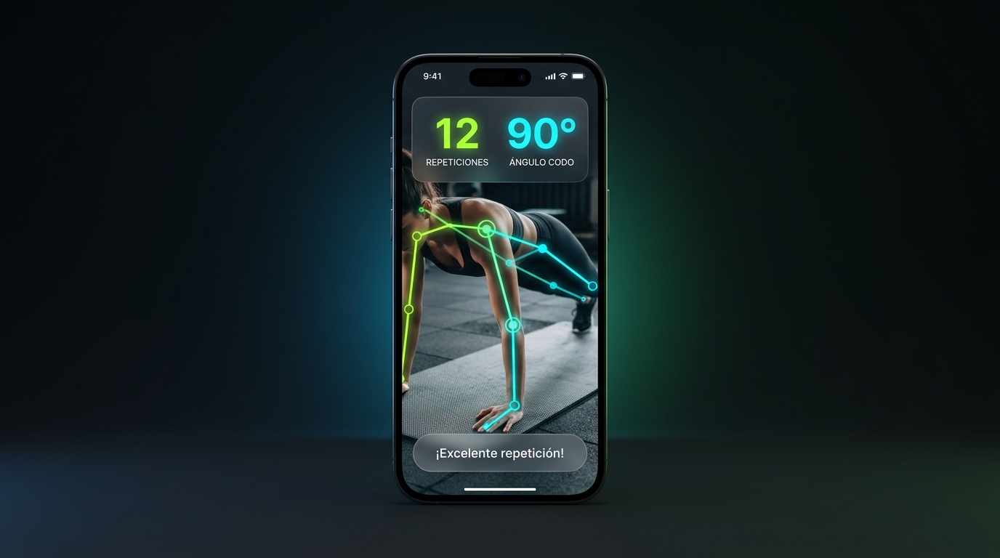

# 🏋️‍♂️ Pose Detection - Contador Inteligente de Flexiones (Push-ups)

<p align="center">
  
  
  
</p>

Aplicación móvil desarrollada en **Flutter** bajo los principios de **Clean Architecture** para la detección y seguimiento de postura corporal en tiempo real. Permite el conteo automático de flexiones de pecho (*push-ups*), análisis biomecánico del ángulo de codo, filtrado anti-fantasmas y retroalimentación interactiva instantánea en español.

---

## 📱 Nueva Interfaz de Usuario

<p align="center">
  
  &nbsp;&nbsp;&nbsp;&nbsp;&nbsp;&nbsp;&nbsp;&nbsp;
  
</p>

<p align="center">
  <em>Izquierda: Pantalla de bienvenida con animación Lottie • Derecha: Nueva interfaz deportiva con Glassmorphism, contador en verde neón, ángulo en cian y feedback dinámico.</em>
</p>

---

## ✨ Características Principales

* 🦾 **Detección Automática de Perfil (Bilateral):** Evalúa la confianza (`likelihood`) de ambos lados corporales y selecciona automáticamente el brazo visible (izquierdo o derecho) para que el usuario pueda ejercitarse mirando hacia cualquier lado.
* 🛡️ **Sistema de 5 Filtros Anti-Posiciones Fantasmas:** Algoritmo biomecánico avanzado que previene falsas detecciones sobre objetos inanimados (zapatos, alfombras, muebles o ventiladores).
* 🎨 **Diseño Moderno (Material 3 Dark Sports):**
  * Paleta deportiva oscura con contrastes neón esmeralda (`#00E676`) y cian (`#00E5FF`).
  * Superposición translúcida (*Glassmorphism*) con contador de repeticiones gigante y medidor del ángulo de codo en tiempo real.
  * Mensajes de guía biomecánica: *"¡Baja más el pecho!"*, *"¡Empuja hacia arriba!"*, *"¡Excelente repetición!"*.
* 🔄 **Control Total de Cámara:** Alternancia instantánea entre cámara trasera y delantera, controles de exposición y zoom, y diálogo de reinicio de contador.
* 🧪 **Suite de Pruebas Unitarias (100% Pasadas):** 8 pruebas automatizadas que validan trigonometría, rechazo de objetos falsos y ciclos de flexión.

---


## 🏛️ Arquitectura del Proyecto (Clean Architecture)

El proyecto está organizado en 4 capas estrictamente desacopladas:
   
```
lib/
├── core/                        # Núcleo y utilidades compartidas
│   ├── constants/               # Textos y mensajes en español (AppStrings)
│   ├── theme/                   # Tema Material 3 oscuro deportivo (AppTheme)
│   └── utils/                   # Cálculo trigonométrico (AngleCalculator) y adaptadores
│
├── domain/                      # Reglas de negocio puras (independiente de frameworks)
│   ├── entities/                # Entidades inmutables (ExerciseMetrics, ExerciseStage)
│   ├── repositories/            # Contratos abstractos (IPoseDetectorRepository)
│   └── usecases/                # Lógica biomecánica y filtros (ProcessPoseUseCase)
│
├── infrastructure/              # Implementaciones técnicas y consumo de hardware/IA
│   ├── datasources/             # Wrapper de Google ML Kit (MLKitPoseDataSource)
│   └── repositories/            # Implementación concreta del repositorio
│
├── presentation/                # Interfaz de usuario y gestión de estado
│   ├── cubit/                   # PushUpCubit y PushUpState (BLoC reactivo)
│   ├── pages/                   # SplashPage, HomePage, PoseDetectorPage
│   └── widgets/                 # ModernCounterOverlay, PosePainter, CameraFeedWidget
│
└── main.dart                    # Punto de entrada de la aplicación
```

---

## 🚀 Requisitos e Instalación

### Requisitos Previos
* **Flutter SDK:** $\ge 3.0.0$ (Probado en Flutter 3.47.7 / Dart 3.13.5).
* **Android:** SDK mínimo 21 (`minSdkVersion 21`), Gradle 9.3+, Kotlin DSL (`.gradle.kts`), Java 17 LTS.
* **Dispositivo:** Teléfono Android físico o emulador con soporte de cámara.

### Pasos para Ejecutar

1. **Clonar el repositorio:**
   ```bash
   git clone https://github.com/albinrk10/Pose_Detection.git
   cd Pose_Detection
   ```

2. **Instalar dependencias:**
   ```bash
   flutter pub get
   ```

3. **Ejecutar la suite de pruebas unitarias:**
   ```bash
   flutter test
   ```

4. **Verificar análisis estático de código:**
   ```bash
   flutter analyze
   ```

5. **Lanzar la aplicación:**
   ```bash
   flutter run
   ```

---

## 📄 Licencia

Este proyecto se distribuye bajo la licencia **MIT**. Siéntete libre de utilizarlo, modificarlo y contribuir.
